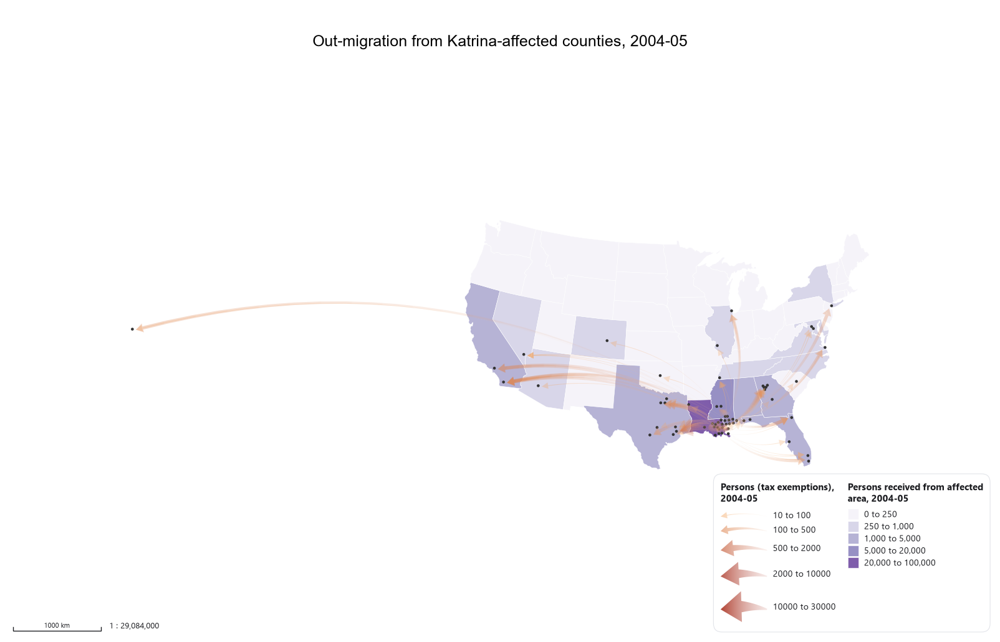
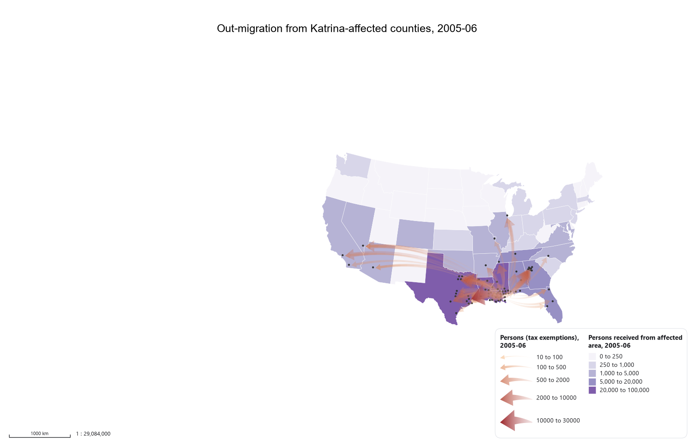

# Disaster migration: Hurricane Katrina and the Camp Fire

County-to-county migration before, during and after two U.S. disasters, from the IRS Statistics of Income
migration data. Each folder has FlowMapper projects for a baseline year and a disaster year. **The two
projects use the same class breaks, so the maps can be compared directly.** Teaching exercises that use these
data are in [Teaching](../../Teaching/).

| Folder | Disaster | Origins | Years |
|---|---|---|---|
| [Katrina](Katrina/) | Hurricane Katrina, August 2005 | Orleans, Jefferson, St. Bernard, Plaquemines and St. Tammany parishes (LA); Hancock, Harrison and Jackson counties (MS) | 2004–05 to 2007–08, out and in |
| [CampFire](CampFire/) | Camp Fire, November 2018 | Butte County, CA (Paradise) | 2017–18 to 2019–20, out |

| Baseline, 2004–05 | Katrina, 2005–06 |
|---|---|
|  |  |

## Files

### Katrina

| File | Contents |
|---|---|
| `flowmapper_katrina_out_2004_05.json`, `flowmapper_katrina_out_2005_06.json` | FlowMapper projects: top 150 flows out of the eight counties; states shaded by persons received |
| `flows_katrina_out_<period>.csv` | Moves out of the eight counties to every other U.S. county |
| `flows_katrina_in_<period>.csv` | Moves into the eight counties (return and replacement migration) |
| `flows_katrina_all_periods.csv` | All of the above in one table, with `period` and `direction` (`out`/`in`) |
| `summary_katrina_counties.csv` | Persons out, in and net for each of the eight counties and each period |
| `regions_states_katrina_totals.csv` | Per state: persons received from (`persons_from_katrina_area_<period>`) and sent to (`persons_to_katrina_area_<period>`) the eight counties; join field `name` |
| `nodes_counties.csv` | County centroids (Census 2010 Gazetteer): `fips`, `county`, `state`, `lon`, `lat`, `katrina_area` (yes/no) |
| `regions_us_states.geojson` | U.S. states without Alaska, Hawaii and Puerto Rico; ID field `name` |

### CampFire

`flowmapper_butte_out_2017_18.json` and `_2018_19.json`, `flows_butte_out_<period>.csv` (2017_18, 2018_19,
2019_20), `nodes_counties.csv` (Census 2019 Gazetteer), `regions_states_butte_totals.csv` and
`regions_us_states.geojson`, with the same fields as above.

### Flow fields

| Field | Meaning |
|---|---|
| `origin`, `destination` | 5-digit county FIPS codes (they match `fips` in `nodes_counties.csv`) |
| `households` | Number of tax returns (approximately households) |
| `persons` | Number of exemptions (2004–08) or individuals (2017–20): approximately people. Used as the flow volume in the projects |
| `agi_thousand_usd` | Adjusted gross income of the movers, thousand US$ |

To build a map yourself: nodes `nodes_counties.csv` (ID `fips`, X `lon`, Y `lat`), flows (origin `origin`,
destination `destination`, volume `persons`), and regions `regions_us_states.geojson` joined to the
`regions_states_*` table with `name` = `name`.

## Notes on the data

* **Who is counted.** Only people who file federal tax returns, and their dependents, in both years.
  Non-filers (many low-income and elderly people) are missing, and these groups are often the most exposed
  to disasters.
* **What a "year" means.** A period compares the addresses on returns filed in two consecutive years.
  2005–06 covers moves between spring 2005 and spring 2006, so it includes Katrina. 2018–19 includes the
  Camp Fire.
* **Small flows are hidden.** County pairs with fewer than about 10 returns are grouped by the IRS into
  "Other flows" and are not included here. Totals in these files are therefore lower than the IRS county
  totals.
* **Moves within a county are invisible.** This matters for the Camp Fire: out-migration from Butte County
  rose only from 8,119 to 11,301 people, although Paradise (about 27,000 residents) was largely destroyed.
  Much of the displacement stayed inside the county.
* Moves abroad, and the few county codes without a Gazetteer centroid, are left out.

## Sources

* IRS Statistics of Income, U.S. Population Migration Data, county-to-county files 2004–05 to 2007–08
  (`county0506.zip`, ...) and 2017–18 to 2019–20 (`countyoutflow1819.csv`, ...),
  [irs.gov/statistics/soi-tax-stats-migration-data](https://www.irs.gov/statistics/soi-tax-stats-migration-data).
* U.S. Census Bureau, Gazetteer files, counties 2010 and 2019 (internal points).
* U.S. state polygons: FlowMapper's built-in states file
  (`Code/WebContent/assets/js/support/us-states.json`).

The files are built by [`Data/scripts/build_refugee_disaster_data.py`](../scripts/).
