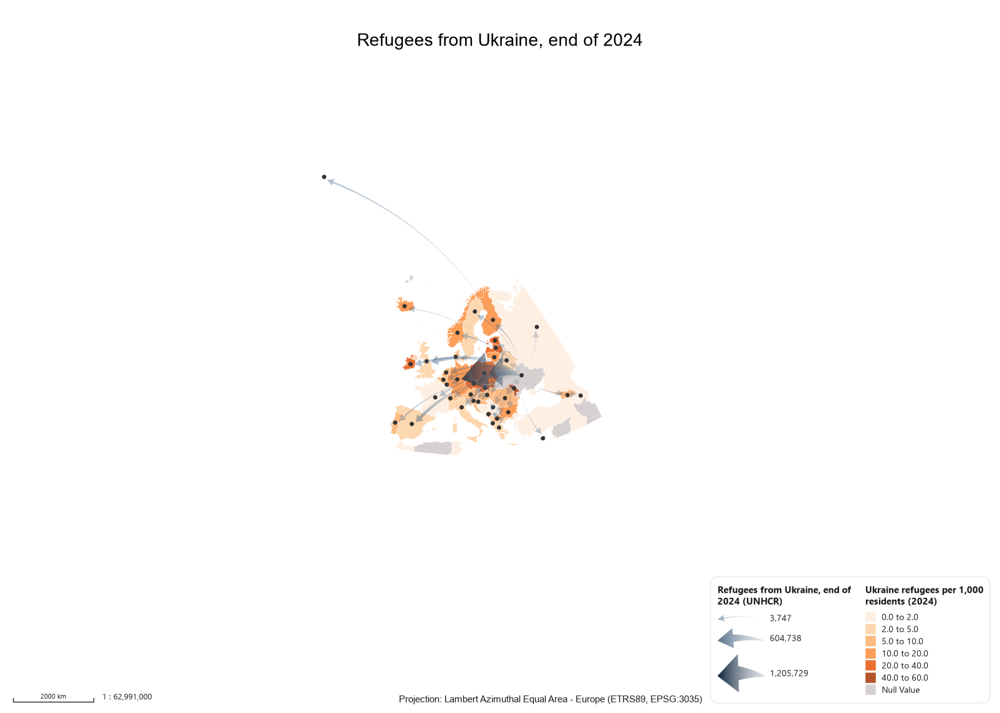

# Refugee flows: Ukraine and Syria

Refugees by country of asylum (UNHCR), with population, GDP and international migrant stock (percent
foreign-born) for every country. Each folder has finished FlowMapper projects and the separate files needed
to build the maps from scratch. Teaching exercises that use these data are in [Teaching](../../Teaching/).

| Folder | Years | Map area |
|---|---|---|
| [Ukraine](Ukraine/) | end of 2022, 2023, 2024 | Europe and neighbours (Lambert Azimuthal Europe) |
| [Syria](Syria/) | end of 2015, 2024 | Europe, Middle East and North Africa (Albers Equal Area Europe) |

## Files (Ukraine; Syria has the same layout)

| File | Contents |
|---|---|
| `flowmapper_ukraine_refugees_2024.json` | FlowMapper project: top 40 flows; countries shaded by refugees per 1,000 residents (manual breaks 0, 2, 5, 10, 20, 40, 60) |
| `flowmapper_ukraine_refugees_2022.json` | FlowMapper project for 2022; countries shaded by refugee count (natural breaks) |
| `*.png` | Previews of the projects |
| `flows_ukraine_refugees_<year>.csv` | Flows: `origin` (ISO3, here UKR), `destination` (ISO3), `destination_name`, `refugees`, `asylum_seekers` |
| `nodes_countries.csv` | One row per country; nodes **and** the region attribute table (see the fields below) |
| `regions_europe.geojson` | Country polygons clipped to the map area, ID field `iso3` (Syria: `regions_europe_mena.geojson`) |
| `table_receiving_countries_2024.csv` | Countries with at least 1,000 refugees, without coordinates: a ready-made table for reports |

To open a project on [FlowMapper.org](https://flowmapper.org): **File > Project > Load Project**. To build the
map yourself, use the nodes file (ID `iso3`, X `lon`, Y `lat`) and a flows file (origin `origin`, destination
`destination`, volume `refugees`). For the regions, load the GeoJSON and join `nodes_countries.csv` with
`iso3` = `iso3`.

### Fields of `nodes_countries.csv`

| Field | Meaning | Source |
|---|---|---|
| `iso3`, `country`, `continent`, `subregion` | Country code and names | Natural Earth |
| `lon`, `lat` | Label point of the country (inside the main land area, better than a centroid for France, Norway, etc.) | Natural Earth |
| `population_2024` | Total population | World Bank SP.POP.TOTL |
| `gdp_per_capita_usd_2024` | GDP per capita, current US$ | World Bank NY.GDP.PCAP.CD |
| `gdp_billion_usd_2024` | GDP, billion current US$ | World Bank NY.GDP.MKTP.CD |
| `migrant_stock_pct_2024` | International migrant stock, % of population (foreign-born, or foreign citizens where birthplace is not recorded) | World Bank SM.POP.TOTL.ZS (UN DESA) |
| `refugees_<year>` | Refugees from Ukraine (or Syria) at the end of the year; blank = none reported | UNHCR |
| `refugees_per_1000_pop_2024` | `refugees_2024 / population_2024 × 1000` | computed |
| `share_of_all_ukr_refugees_pct_2024` | Share of all refugees from the country of origin (Syria: `..._syr_...`) | computed |

World Bank values are for 2024, or for the latest earlier year available (2015 or later).

## Notes on the data

* **Stocks, not flows.** UNHCR figures are people present at the end of the year. Mapping them from the
  country of origin shows where people *are*, not when or by which route they arrived. Moves between host
  countries are not visible.
* **Definitions differ by country.** UNHCR counts people under the EU's Temporary Protection as refugees. The
  United States admitted most Ukrainians through humanitarian parole (Uniting for Ukraine), which is not
  counted, so the U.S. shows only 3,397 refugees from Ukraine in 2024.
* **Reporting changes.** Refugees from Ukraine in the Russian Federation fall from 1.28 million (2022) to
  about 7,000 (2024). This reflects what is reported for the Russian Federation, not a movement of people.
  See the notes on UNHCR's Refugee Data Finder.
* Rows with an unknown country of asylum (0 refugees) were left out.

## Sources

* UNHCR Refugee Data Finder, api.unhcr.org/population/v1 (end-year figures; downloaded November 2026).
* World Bank, World Development Indicators (downloaded November 2026).
* Natural Earth, 1:50m Admin 0 countries (public domain), simplified and clipped.

The files are built by [`Data/scripts/build_refugee_disaster_data.py`](../scripts/).
