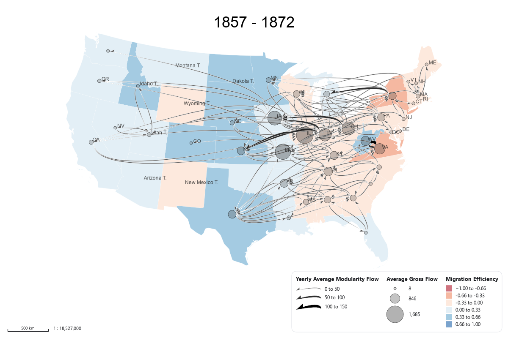
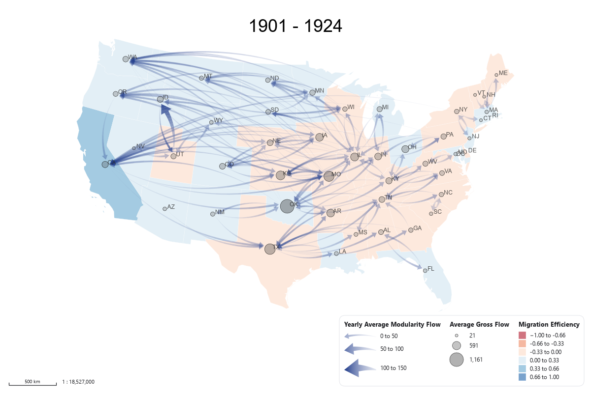
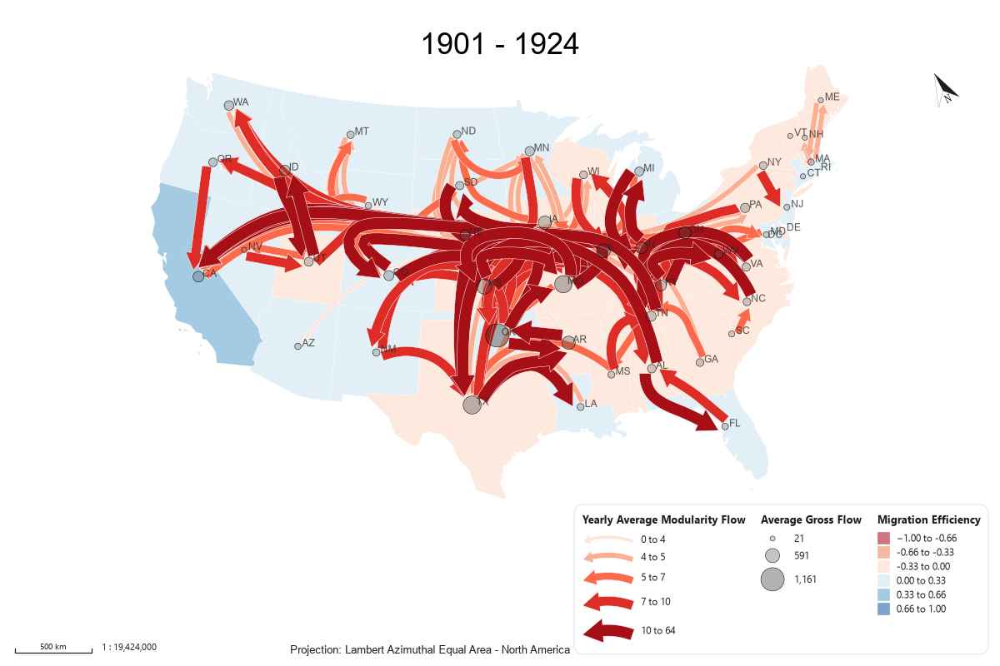
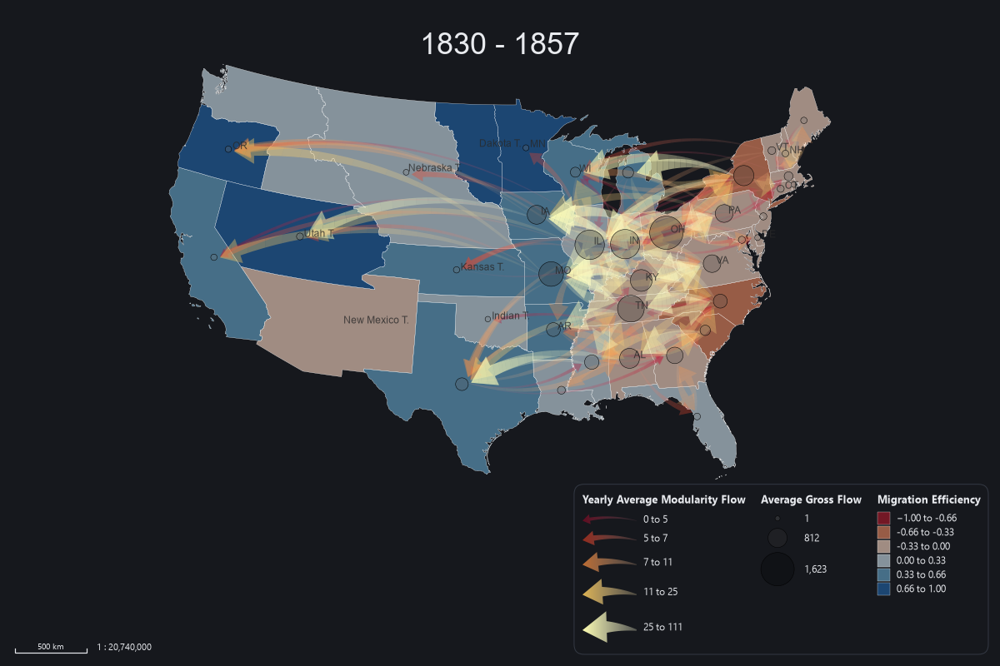

# flowmapper.org

**The Python companion to [FlowMapper.org](https://flowmapper.org).** Read, analyse, map and
write FlowMapper project files from Python. A project built in Python opens on FlowMapper.org, and
every project saved on FlowMapper.org loads in Python, without loss.

```bash
pip install flowmapper.org        # PyPI name (normalised to flowmapper-org)
```
```python
import flowmapper_org as fm
```

> The package is called `flowmapper.org` because the name `flowmapper` on PyPI belongs to an
> unrelated project (mappings between elementary flow lists). The import name is `flowmapper_org`
> and the command line is `flowmapper-org`.



FlowMapper.org is the reference implementation. Every computation in this package (classification,
colours, node measures, top-flow selection, flow-symbol geometry, edge bundling, community
detection, shapefile reading, projections) is checked by *parity tests* that run FlowMapper's own
JavaScript in a V8 engine and require the same results. In most cases they are bit-identical.

## Install

```bash
pip install -e .                 # from this folder
pip install -e ".[interactive]"  # + notebook widget (anywidget)
pip install -e ".[dev]"          # + test tools (pytest, hypothesis, mini-racer)
```

Python ≥ 3.9. Core dependencies: numpy, pandas, matplotlib, shapely, pyproj.

## Quick start

```python
import flowmapper_org as fm

# Open a project saved on FlowMapper.org (File > Project > Save Project)...
p = fm.Project.load("projectfile.json")

# ...or build one from tables (field names are guessed as on the web site)
p = fm.Project.from_data("nodes.csv", "flows.csv", regions="states.zip")

p.flow_settings["flowStyleName"] = "TAF"          # Tapered Fading Arc (the default; stored as "nyt")
p.flow_settings["cfMethod"] = "NaturalBreak"
p.flow_settings["numTopFlows"] = 200

p.save_map("map.png")                             # static map (PNG, JPG, TIF, SVG, PDF)
p.to_html("map.html")                             # interactive map, standalone HTML
p.save("projectfile.json")                        # open it on FlowMapper.org
```

In a notebook, `p.interactive()` shows the same map as a widget. Pan and zoom recompute the flow
symbols in the browser with FlowMapper's own drawing code.

**Flow styles.** `flowStyleName` takes FlowMapper's values or these short names: `"TAF"` Tapered
Fading Arc (FlowMapper's default, value `"nyt"`), `"CHA"` Curve Half Arrow, `"SHA"` Straight Half
Arrow, `"CFA"` / `"SFA"` Curve / Straight Full Arrow, `"TD"` Tear Drop (or the full labels). The
project file stores FlowMapper's value, so it still opens on the web site.

**Figure-ground contrast.** Flows should stand out from the regions and base map. Use dark flow
colours at full opacity (`clrScheme="Custom"` with a mid-tone `minCustomColor` and a dark
`maxCustomColor`), pale regions (`region_settings["fillOpacity"]` 25–45), and nodes on top
(`view_settings["drawingOrder"] = "nodes"`). Two drawing options of the static renderer go further.
They exist only in Python and are not saved in the project file:

```python
p.save_map("map.png", flow_contrast=0.5,               # Tapered Fading Arcs more opaque (0-1)
           flow_halo=("#ffffff", 0.7))                 # thin white casing around every flow
```

The [example notebooks](https://github.com/geo-social/flowmapper/tree/main/python/notebooks) start with a guide to every setting (`00_parameters_guide`).

## What is included

| Area | Module | FlowMapper counterpart |
|---|---|---|
| Project files, settings, migrations | `project` | `SaveProject.js`, `LoadProject.js` |
| CSV and JavaScript value semantics | `data` | `d3.csv`, `+v`, `toFixed` |
| Colour schemes, classification, legends | `colors`, `classify` | `Map.js`, `ColorSchemes.js`, `DrawChoroplethMap.js`, `DrawPoints.js`, `DrawFlows.js`, `NodeCategories.js` |
| Node measures, top flows, what is drawn | `measures` | `Map.js`, `LoadFlows.js` |
| Tools menu | `tools` | `Tools.js`, `FlowCoordinatesToNodes.js`, `FieldGuess.js`, Java servlets |
| Community detection, regionalisation | `community` | `CommunityDetection.js` |
| Shapefiles, regions, joins, references | `shapefile`, `regions` | `ShapefileReader.js`, `RegionData.js`, `LoadChoroplethMap.js` |
| Flow symbols, bundling | `geometry` | `DrawFlows.js`, `FlowSymbology.js`, `FlowBundling.js`, `DrawFlowLegend.js` |
| Projections, scale, north arrow | `projections` | `BaseMapInit.js`, `AddNorthArrow.js` |
| Static maps | `render` | the SVG map and `Export.js` |
| Interactive maps | `interactive` | the web map itself (OpenLayers + FlowMapper geometry) |
| Command line | `cli` | |

### Analysis

```python
fm.node_measures(p.flows, "origin", "destination", "volume")   # in, out, gross, net, net-flow ratio

from flowmapper_org.tools import convert_flow_matrix_to_flow_list, convert_flow_coordinates_to_nodes, \
    polygon_centroids, modularity_flows, network_node_measures

res = fm.detect_communities(p, method="scleiden", resolution=1.0, runs=10, seed=1)
res.modularity, res.membership, res.region_flows
res.to_project().save("regions.json")   # regions, region nodes and region flows as a FlowMapper project
```

With the same seed, community detection returns the same partition as FlowMapper.org: it uses the
same random-number generator and the same order of operations.

### Static maps

```python
r = p.render(width=1200, height=800, dpi=192, projection="laeaNA", dark=False)
r.fig        # matplotlib Figure; r.legends, r.notices, r.view for inspection
r.save("map.svg")
```

All flow styles, gradients (Tapered Fading Arc, 2- and 3-stop linear), categorical and negative
node values, choropleth regions, references, legends, title, north arrow, scale bar and
projection label. Each layer is one matplotlib collection, so rendering is fast: 1000 flows and
3000 nodes take about 1–1.5 s.

| Tapered Fading Arc | Bundled full arrows (Lambert azimuthal) | Dark mode |
|---|---|---|
|  |  |  |

### Interactive maps

```python
from flowmapper_org.interactive import flowmap, to_html
w = flowmap(p)                    # anywidget for Jupyter / VS Code
w.update(flow_style="curveFull", cf_method="Quantile", num_top_flows=300)
to_html(p, "map.html")            # self-contained file (basemap tiles need a connection)
```

The interactive map uses OpenLayers, proj4 and d3 copied from FlowMapper, plus the flow-outline
functions extracted from FlowMapper's `DrawFlows.js`. It looks the same as flowmapper.org, in all
of FlowMapper's projections. Hover a flow or node for its values; click a node to show only its
outgoing, incoming or all flows.

For very large flow data (10⁴–10⁶ flows), reduce the data in Python (top flows, communities,
regions) and use a GPU renderer such as [lonboard](https://developmentseed.org/lonboard/) or
pydeck (deck.gl).

### Command line

```bash
flowmapper-org info projectfile.json
flowmapper-org render projectfile.json -o map.png --width 1600 --height 1000 --dpi 192
flowmapper-org convert --nodes nodes.csv --flows flows.csv --regions states.zip -o projectfile.json
flowmapper-org measures projectfile.json -o node_measures.csv
flowmapper-org tools matrix-to-list matrix.csv -o flows.csv
flowmapper-org tools coords-to-nodes trips.csv --precision 4
flowmapper-org tools communities projectfile.json --resolution 1.0 --seed 1 --project-out regions.json
```

Run `flowmapper-org COMMAND --help` for every option.

## Development

This package is developed together with FlowMapper.org. FlowMapper.org is the reference
implementation: in the development repository, *parity tests* run FlowMapper's own JavaScript in a V8
engine and compare it with the Python port on fixed, random and real data, and a sync check lists
every web-app change that the package has not followed yet. Releases are exported from there into
this folder and published to PyPI by GitHub Actions.

A feature map, with every FlowMapper function and its Python counterpart, is in
[docs/feature_map.md](https://github.com/geo-social/flowmapper/blob/main/python/docs/feature_map.md).

Run the tests of this folder (tests that need the FlowMapper.org sources are skipped):

```bash
git clone https://github.com/geo-social/flowmapper
cd flowmapper/python
python -m pip install -e ".[interactive]" pytest hypothesis
python -m pytest -m "not parity"
```

Please report problems at <https://github.com/geo-social/flowmapper/issues>.

## Known differences from FlowMapper.org

The port mirrors FlowMapper's behaviour, including cases that look like bugs in the web app. These
are listed for the maintainers in [docs/js_behaviour_notes.md](https://github.com/geo-social/flowmapper/blob/main/python/docs/js_behaviour_notes.md).
Deliberate differences:

- The North arrow off the edge of the globe points straight up instead of returning an angle for a
  point that is not on the map.
- Basemap tiles in static maps need the optional `contextily` package and a connection.

## Citation

If you use this package, please cite FlowMapper.org and this package; a paper describing both is in
preparation.
